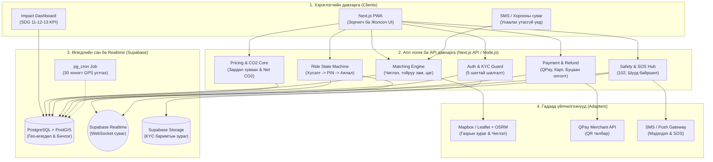
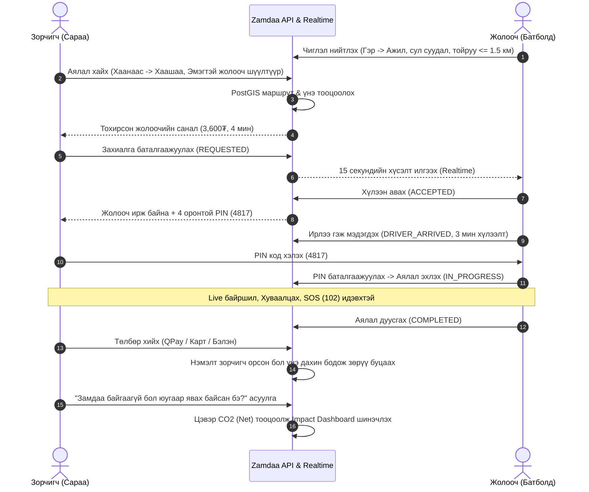
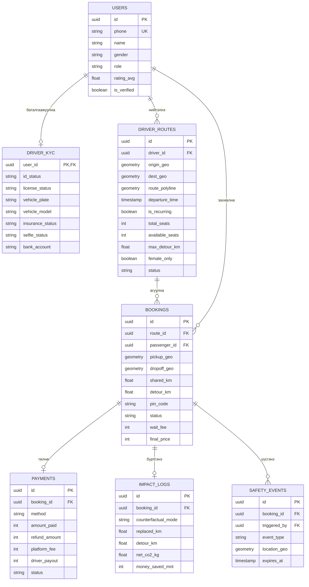

# Замдаа — Системийн Архитектурын Баримт

**Төслийн нэр:** Замдаа (Ухаалаг хамтран зорчих систем)  
**Хичээл:** Тогтвортой хөгжлийн дижитал хэрэгсэл (SDG 11, 12, 13)  
**Технологийн стек:** Next.js (App Router) · TypeScript · Tailwind CSS · Supabase (PostgreSQL + PostGIS + Realtime) · Mapbox / Leaflet + OSRM  

---

## 1. Архитектурын ерөнхий зарчим

**Замдаа** нь **Модульчлагдсан Монолит (Modular Monolith) + Event/Realtime** архитектураар зохион байгуулагдана. Энэ бүтэц нь хичээлийн богино хугацаанд бүрэн ажилладаг MVP бүтээх, цаашид бодит ачаалал руу өргөтгөхөд хамгийн тохиромжтой.

Систем дараах 3 үндсэн зарчмыг техникийн түвшинд албадан мөрдүүлнэ:
1. **Ашгийн такси биш (Cost-Sharing Guard):** Жолоочийн нийт орлого машины бодит зардлын $\le 100\%$ дотор хязгаарлагдана.
2. **Шударга $\text{CO}_2$ тооцоолол (Anti-Greenwashing):** Аялал бүрийн дараах орлуулалтын асуулгаар цэвэр (net) ялгаруулалтыг тооцно.
3. **Хүртээмж ба Аюулгүй байдал:** 5 шаттай жолоочийн баталгаажуулалт (KYC), 4 оронтой PIN, SOS (102), 30 хоногийн GPS өгөгдөл устгал болон бага дата/SMS дэмжлэгтэй байна.

---

## 2. Системийн ерөнхий бүтэц (High-Level Architecture)



---

## 3. Аяллын амьдралын мөчлөг (Sequence Diagram)

Зорчигч захиалга өгөхөөс эхлээд төлбөр болон цэвэр $\text{CO}_2$ бүртгэх хүртэлх бодит цагийн урсгал:



---

## 4. Үндсэн модулиуд ба Тооцооллын цөм

### 4.1. Маршрут тааруулах цөм (`lib/engines/matcher.ts`)
* Жолоочийн нийтэлсэн чиглэлийг PostGIS `LineString` хэлбэрээр хадгална.
* Шүүлтүүрийн нөхцөлүүд:
  * Зорчигчийн авах болон буулгах цэг нь чиглэлийн дагуу зөв дараалалтай байх.
  * Нэмэгдэх тойруу зам жолоочийн зөвшөөрсөн хязгаараас хэтрэхгүй байх (жишээ нь $\le 1.5\text{ км}$).
  * Хөдлөх цагийн зөрүү $\le 10\text{ мин}$ байх.
  * Сул суудал $\ge 1$ болон *Зөвхөн эмэгтэй жолооч/зорчигч* тохиргоо таарах.

### 4.2. Үнэ ба Зардал хуваах цөм (`lib/engines/pricing.ts`)
Бүх тооцоо сервер талд нэгдсэн параметрээр бодогдоно:
* Машины бодит зардал: $C = 500\text{ ₮/км}$ (шатахуун $300\text{ ₮/км}$ + элэгдэл, засвар, даатгал $200\text{ ₮/км}$)
* Суурь тариф: $T = 600\text{ ₮/км}$, Платформын хураамж: $10\%$, Жишиг такси: $2{,}000\text{ ₮/км}$

Зорчигчийн тоо $n$, хамт явах зай $d\text{ (км)}$, тойруу зам $\Delta d\text{ (км)}$ үед нэг зорчигчийн төлөх үнэ ($100\text{ ₮}$ рүү доош бүхэлтгэнэ):

$$P_{\text{зорчигч}} = \left\lfloor \frac{\min\left(600 \cdot d,\; \frac{C \cdot (d + \Delta d)}{0.9 \cdot n}\right)}{100} \right\rfloor \times 100$$

* **Жолоочид орох цэвэр орлого:** $E_{\text{жолооч}} = P_{\text{зорчигч}} \times n \times 0.9$ (үргэлж $\le C \cdot (d + \Delta d)$ байна)
* **Замдаа үйлчилгээний хураамж:** $F_{\text{платформ}} = P_{\text{зорчигч}} \times n \times 0.1$
* **Зорчигчийн хэмнэлт:** $S = 2{,}000 \cdot d - P_{\text{зорчигч}}$
* **Динамик буцаан олголт:** Тухайн аялалд $n$ өсөх бүрт (жишээ нь $6\text{ км}$ аялалд $n=1 \rightarrow 3{,}600\text{ ₮}$, $n=2 \rightarrow 2{,}000\text{ ₮}$) өмнөх зорчигчийн зөрүү ($1{,}600\text{ ₮}$) автоматаар буцаан олголтын бүртгэлд орно.

### 4.3. Цэвэр $\text{CO}_2$ тооцоолуур (`lib/engines/co2.ts`)
Бензиний ялгаралтын коэффициент: $e = 2.31\text{ кг/л} \times 0.09\text{ л/км} = 0.208\text{ кг }\text{CO}_2/\text{км}$.

Аяллын дараах *"Замдаа байгаагүй бол юугаар явах байсан бэ?"* хариултаас хамаарч:
* **Такси / Хувийн машин орлосон бол:**
  $$\Delta \text{CO}_2 = -(d - \Delta d) \times 0.208\text{ кг}$$
* **Автобус / Алхах / Явахгүй сонгосон бол (тойруу замын ул мөрийг шударгаар бүртгэнэ):**
  $$\Delta \text{CO}_2 = +\Delta d \times 0.208\text{ кг}$$

### 4.4. Аюулгүй байдал ба Өгөгдлийн хамгаалалт
* **5 шаттай KYC:** Иргэний үнэмлэх, B ангиллын $2+$ жилийн жолооны үнэмлэх, тээврийн хэрэгсэл, хариуцлагын даатгал, селфи баталгаажуулалт.
* **Аяллын хамгаалалт:** 4 оронтой PIN баталгаажуулалт, итгэмжлэгдсэн хүнд байршил хуваалцах түр линк, нэг товшилтоор 102 болон гэр бүлд мэдэгдэх SOS товч.
* **Хүлээлтийн дүрэм:** Жолооч ирснээс хойш хүлээлт $3\text{ минутаас}$ хэтэрвэл $500\text{ ₮}$ хүлээлтийн төлбөр нэмэгдэнэ.
* **Нууцлал:** Нарийвчилсан GPS цэгүүд `pg_cron` ашиглан $30\text{ хоногийн}$ дараа автоматаар устгагдана.

---

## 5. Өгөгдлийн сангийн схем (Supabase / PostgreSQL + PostGIS)



---

## 6. Гол API Endpoint ба Realtime сувгууд

| Метод ба Зам | Үүрэг | Хэрэглэгч |
| :--- | :--- | :--- |
| `POST /api/routes` | Жолооч чиглэл нийтлэх, урьдчилсан орлого/шатахууны нөхөлт тооцох | Жолооч |
| `POST /api/match` | Чиглэл, цаг, тойруу зам, хүйсийн шүүлтүүрээр жолооч хайх | Зорчигч / SMS |
| `POST /api/bookings` | Захиалга үүсгэж жолоочид 15 сек хүсэлт илгээх | Зорчигч |
| `PATCH /api/bookings/[id]/status` | Хүлээн авах, татгалзах, ирлээ мэдэгдэх, дуусгах | Жолооч / Зорчигч |
| `POST /api/bookings/[id]/verify-pin` | 4 оронтой PIN шалгаж аяллыг `IN_PROGRESS` төлөвт оруулах | Жолооч |
| `POST /api/payments/qpay` | QPay QR үүсгэх болон төлбөр баталгаажуулах (Webhook / Mock) | Зорчигч |
| `POST /api/bookings/[id]/impact` | Орлуулалтын асуулга хадгалж цэвэр $\text{CO}_2$ тооцох | Зорчигч |
| `POST /api/safety/sos` | SOS мэдэгдэл үүсгэж байршил, машины мэдээлэл илгээх | Хоёр тал |
| `GET /api/dashboard/metrics` | Нийт хамтарсан аялал, суудал, хэмнэсэн км, цэвэр $\text{CO}_2$ | Нээлттэй / Админ |

**Supabase Realtime сувгууд:**
* `driver:{driver_id}:requests` — Шинэ зорчигчийн 15 секундийн хүсэлт хүлээн авах.
* `booking:{booking_id}:state` — Захиалгын төлөв, PIN баталгаажуулалт, үнийн өөрчлөлт шууд шинэчлэгдэх.
* `ride:{route_id}:location` — Аяллын үеийн жолоочийн GPS байршлыг зорчигч болон хуваалцсан линк рүү дамжуулах.

---

## 7. Next.js төслийн фолдер бүтэц

```text
zamdaa-app/
├── ARCHITECTURE.md                   # Энэхүү архитектурын баримт
├── supabase/
│   └── migrations/                   # SQL схем, PostGIS, RLS болон pg_cron
├── src/
│   ├── app/
│   │   ├── page.tsx                  # Landing page (Гурван алхам, Нөлөө, Аюулгүй байдал)
│   │   ├── (passenger)/              # Зорчигчийн урсгал
│   │   │   ├── search/page.tsx       # Чиглэл хайх & эмэгтэй жолооч шүүлтүүр
│   │   │   ├── ride/[id]/page.tsx    # Таарсан жолооч, PIN, Live газрын зураг, SOS
│   │   │   └── payment/[id]/page.tsx # QPay/Карт/Бэлэн, баримт & CO2 асуулга
│   │   ├── (driver)/                 # Жолоочийн урсгал
│   │   │   ├── onboarding/page.tsx   # 5 шаттай KYC баталгаажуулалт
│   │   │   ├── publish/page.tsx      # Чиглэл нийтлэх & урьдчилсан тооцоо
│   │   │   ├── active/[id]/page.tsx  # 15 сек хүсэлт авах, PIN оруулах дэлгэц
│   │   │   └── earnings/page.tsx     # Долоо хоногийн орлого, шатахууны нөхөлт %
│   │   ├── dashboard/page.tsx        # Нийт нөлөөний самбар (SDG 11-12-13 KPI)
│   │   └── api/                      # Backend Route Handlers
│   ├── lib/
│   │   ├── engines/
│   │   │   ├── pricing.ts            # Үнэ, <=100% хязгаар, буцаан олголт
│   │   │   ├── co2.ts                # Counterfactual цэвэр CO2 тооцоолуур
│   │   │   └── matcher.ts            # Тойруу зам & цагийн эрэмбэлэлт
│   │   ├── adapters/                 # QPay, SMS, Map (MVP Mock / Production солих)
│   │   └── supabase/                 # DB client, Realtime hooks, Auth helpers
│   └── components/
│       ├── map/                      # Mapbox эсвэл Leaflet + OSRM компонент
│       ├── shared/                   # PIN input, SOS modal, CO2 badge, Demo Role Switcher
│       └── ui/                       # Tailwind суурь UI компонентууд
```

---

## 8. MVP (Хичээлийн демо) ба Production зааг

Гадаад үйлчилгээнүүдийг **Adapter Pattern** ашиглан тусгаарласнаар хичээлийн хамгаалалтын дараа бодит API руу шилжихэд үндсэн логик өөрчлөгдөхгүй.

| Бүрэлдэхүүн | Хичээлийн MVP (Одоо хийх) | Бодит систем (Production) |
| :--- | :--- | :--- |
| **Frontend & UI** | Figma-ийн бүх дэлгэц (Landing, Зорчигч, Жолооч, Dashboard) | PWA + Push Notification бүрэн тохиргоо |
| **DB & Realtime** | Бодит Supabase (PostgreSQL + Realtime хоёр цонхоор холбогдоно) | PostGIS индекс + Read replica + Auto backup |
| **Тооцооллын цөм** | Бодит `pricing.ts` ба `co2.ts` (динамик үнэ, цэвэр $\text{CO}_2$) | Өөрчлөгдөхгүй (ижил код ажиллана) |
| **Газрын зураг** | Үнэгүй `Leaflet + OpenStreetMap + OSRM` эсвэл Mapbox Free Tier | Mapbox / Google Maps Directions API |
| **QPay төлбөр** | QR дэлгэц + "Төлбөр баталгаажуулах (Demo)" Mock Webhook | Бодит QPay Merchant API & Callback |
| **KYC ба SMS/SOS** | Зураг хадгалах + Demo баталгаажуулах товч, Toast/Log мэдэгдэл | ДАН / ХУР систем, SMS Gateway, 102 интеграци |

---

## 9. Багийн үүрэг хуваарилалтын санал

Хөгжүүлэлтийг зэрэгцүүлэн хурдан ахиулахын тулд ажлыг 4 үндсэн чиглэлд хувааж болно:

- [ ] **Чиглэл 1 — Backend, DB & Core Engines:** Supabase хүснэгтүүд, Realtime тохиргоо, `pricing.ts`, `co2.ts`, `matcher.ts` бичих.
- [ ] **Чиглэл 2 — Зорчигчийн урсгал (Frontend):** Landing page, Хайлт, Тааруулах дэлгэц, Төлбөр/Баримт ба $\text{CO}_2$ асуулга.
- [ ] **Чиглэл 3 — Жолоочийн урсгал (Frontend):** 5 шаттай KYC, Чиглэл нийтлэх, 15 сек хүсэлт + PIN дэлгэц, Орлогын тайлан.
- [ ] **Чиглэл 4 — Газрын зураг, SOS & Impact Dashboard:** Интерактив газрын зураг, шууд байршлын хөдөлгөөн, SOS урсгал, SDG KPI самбар.